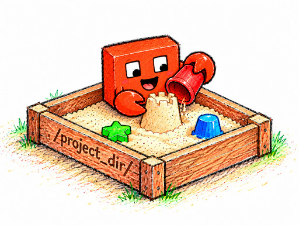

<div align="center">



# nonoclaude

**Let Claude Code skip permission prompts without handing it your whole machine.**

</div>

Approving every command Claude Code wants to run gets old fast. Turning the prompts off with `--dangerously-skip-permissions` means trusting it with your SSH keys, your browser profiles, and everything else in your home directory. nonoclaude sits in between: it runs Claude Code with that flag, but inside a [nono](https://nono.sh/) sandbox. The limits are enforced by the operating system itself (Landlock on Linux, Seatbelt on macOS), so they hold even if the agent ignores what it's told.

Here's what Claude can do inside the sandbox:

- write to the directory you launched it from, temporary directories, `~/.claude`, and `~/.claude.json`
- read everything else, except your secrets: SSH and GPG keys, keyrings, password stores, browser profiles, `.netrc`, `.npmrc`, shell rc files, and nono's own state. On macOS, Mail, Messages, and Safari data are off limits too.
- use the network

Think of it as protection against accidents, like a stray `rm` or a script that writes where it shouldn't. It won't stop an agent that's actively trying to break out. The [Limits](#limits) section is honest about where the walls are.

## Install

nonoclaude runs on Linux, WSL2, and macOS. You'll need `python3`, [nono](https://docs.nono.sh/cli/getting_started/installation) (`brew install nono` on macOS), and [Claude Code](https://code.claude.com/docs/en/setup).

**A heads-up for Mac users: macOS support is new, and I haven't tested it on a real Mac yet.** If something breaks, please open an issue with the error. It helps a lot.

```sh
curl -fsSL https://raw.githubusercontent.com/Glaicer/nonoclaude/main/install.sh | bash
```

The installer will:

1. put the launcher at `~/.local/bin/nonoclaude`
2. create `~/.config/nono/claude-dev.json` from [`profile.linux.json`](profile.linux.json) or [`profile.macos.json`](profile.macos.json), unless you already have one
3. ask whether Claude may read `~/.ssh/known_hosts`, which Git over SSH needs to verify servers (default: yes; your keys stay blocked either way)
4. ask whether to add the `claude` shell integration to your `.zshrc` or `.bashrc` (default: yes)

Running it again is safe, so don't worry about doing it twice.

One more thing before your first sandboxed session: log in with `claude auth login`. Login doesn't work inside the sandbox. If you set up the shell integration, `claude auth` always runs outside it, so you don't have to think about it.

## Usage

```sh
cd ~/code/my-project
nonoclaude            # any claude flags work: -c, -p "...", --model ...
```

With the shell integration, you can just type `claude` and it picks the mode for you:

| Where / what                                     | Runs                                  |
| ------------------------------------------------ | ------------------------------------- |
| any directory except `~` and `/tmp`              | sandboxed; that directory is writable |
| `~` or `/tmp`                                    | unsandboxed                           |
| `claude --no-sandbox ...`                        | unsandboxed                           |
| `auth`, `mcp`, `plugin`, `update`, `doctor`, ... | unsandboxed                           |

If you start plain `claude` with no arguments in `~`, it opens in `/tmp` instead. That way a quick chat or a throwaway task leaves its files in `/tmp` and your home directory stays tidy.

## How it works

`nonoclaude` is a single Python file with no dependencies. Each time you launch it, it:

1. reads `~/.config/nono/claude-dev.json`
2. builds a nono profile for the current directory. Landlock can't deny a path inside one it has already granted, so you can't grant `/` and then carve out `~/.ssh`. Instead, nonoclaude grants each sibling of every excluded path.
3. on macOS, adds nono's `claude_code_macos` group and lifts nono's Keychain deny for `~/Library/Keychains`. Claude Code keeps its login there and refreshes it during a session, so it needs the access.
4. writes the profile to `$XDG_RUNTIME_DIR/nonoclaude/` (on macOS, `~/.cache/nonoclaude/`), somewhere the sandbox can't write, and `exec`s `nono run`, which starts `claude` with:
   - `--dangerously-skip-permissions`
   - `--append-system-prompt`: tells Claude it's sandboxed, and that when something gets blocked it should ask you instead of retrying or finding a way around it
   - `DISABLE_AUTOUPDATER=1`: the Claude binary isn't writable from inside the sandbox, so you update it with `claude update` from outside

## Configuration

Everything the sandbox allows lives in `~/.config/nono/claude-dev.json`. Edit it **outside** the sandbox, then restart your session to pick up the changes.

The most common reason to touch it is a package manager. They like to write caches outside your project, and the sandbox will block that. When it happens, add the specific path to your `write` list:

```json
{
  "write": ["$HOME/.npm", "$HOME/.cargo/registry", "$XDG_CACHE_HOME/go-build"]
}
```

| Key               | Meaning                                                  |
| ----------------- | -------------------------------------------------------- |
| `read`            | readable roots                                           |
| `write`           | writable paths; missing directories are created          |
| `exclude`         | removed from `read` and `write` (globs allowed)          |
| `read_exceptions` | excluded paths to make readable again, e.g. `known_hosts` |

Paths can use `$HOME`, `$XDG_CONFIG_HOME`, `$XDG_CACHE_HOME`, `$XDG_DATA_HOME`, and `$XDG_STATE_HOME`. Keep in mind that grants apply to every project, so please never add all of `$HOME`.

## Limits

I'd rather you know the gaps up front:

- `~/.claude` has to be writable, and it holds `settings.json`. If the agent writes a hook there, that hook runs unsandboxed the next time you start Claude outside the sandbox: in `~`, in `/tmp`, or with `--no-sandbox`.
- The network is open, so anything the agent can read, it can also send somewhere.
- On macOS, the agent can use your login Keychain, the same way the Claude Code process does. Items that belong to other apps still need your approval in a macOS prompt.
- If the agent writes a script and you run it yourself outside the sandbox, nothing restricts it.

## Development

```sh
python3 -m unittest -v   # needs nono on PATH
ruff check . && ruff format --check .
```

## Are you an agent?

If you're installing or setting up nonoclaude for a user, follow [docs/agent-install.md](docs/agent-install.md) step by step. Don't improvise from this README.
